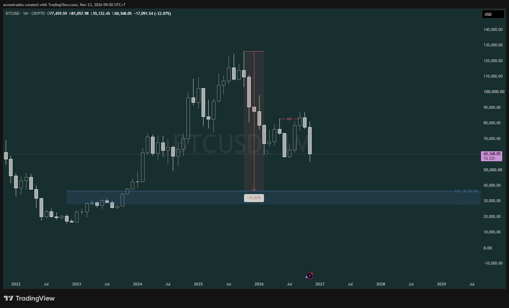
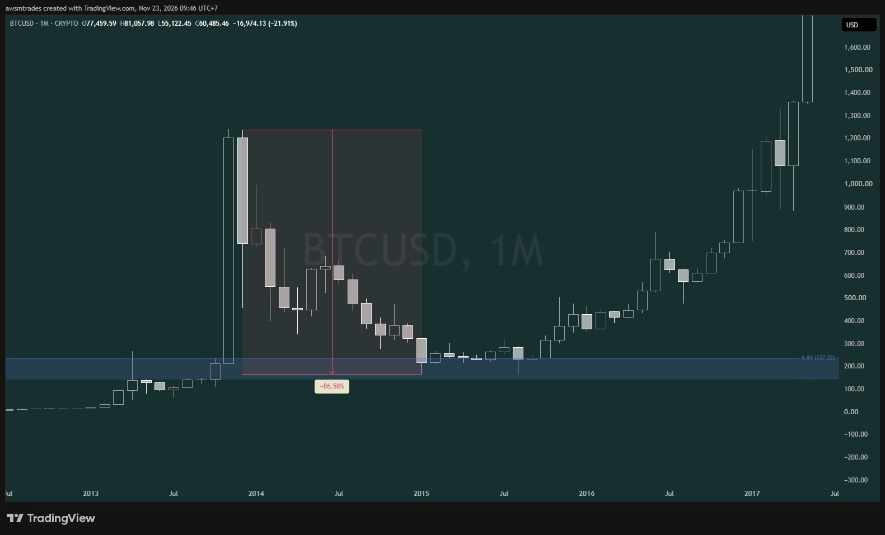
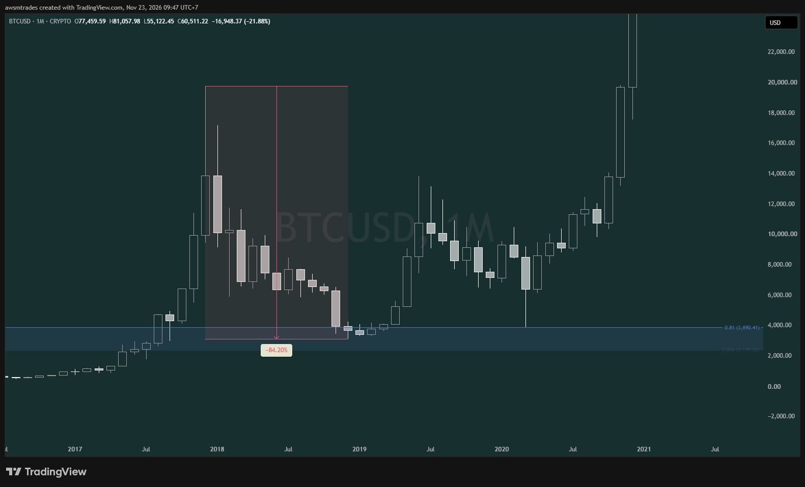
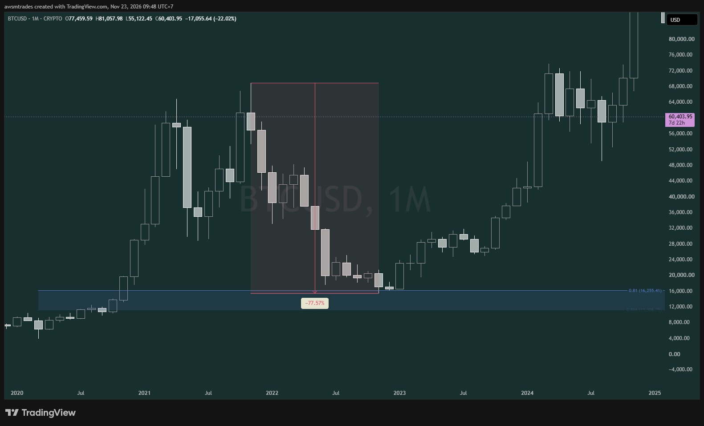

Bitcoin pagi ini di 60,8 ribu. Seminggu yang brutal: sempat jebol ke 55.130 hari Sabtu, tapi penutupan mingguan Senin pagi di 60.784 — masih di atas low Juni 58.524, turun 7% dalam seminggu. Pertanyaan yang muncul di mana-mana sama: ini sudah bottom, atau belum?

Saya tidak menebak bottom. Saya menggambar zona.

Di chart bulanan saya ada zona biru besar di bawah: **36,5 ribu sampai 28,1 ribu**. Itu area akumulasi saya. Harga sekarang masih 66% di atas tepi atasnya. Jadi jawaban saya untuk pertanyaan di atas sederhana: di harga sekarang, saya tidak melakukan apa-apa.

## Kenapa harga bisa sampai ke sana?

Selama ini bacaan saya begini: low bulan Juni (58,5 ribu) adalah bottom, kenaikan sesudahnya sampai 87 ribu adalah wave pertama, dan penurunan sekarang cuma koreksi — yang harusnya berhenti di sekitar 67 ribu.

Masalahnya, koreksi yang sehat tidak turun sejauh ini. Harga sekarang sudah di bawah titik awal kenaikannya sendiri. Dalam aturan wave yang saya pakai, itu artinya hitungannya mati: ini bukan koreksi lagi. Ini lanjutan turunnya.

Kalau itu yang terjadi, berhentinya bukan di angka koreksi. Berhentinya di angka bear market. Dan buat bear market, saya nggak menebak dari nol — saya lihat sejarahnya.

Tiga bear market terakhir, Bitcoin selalu jatuh sampai area fibo 0,81–0,886 dari kaki naiknya. Bear 2014–2015 berhenti di −86,6%. Bear 2018 berhenti di −84,2%. Bear 2022 berhenti di −77,6%. Kedalamannya memang makin dangkal tiap siklus — tapi ketiganya mendarat di area yang sama.

Area yang sama buat siklus ini ada di 36,5 ribu sampai 28,1 ribu. Di situlah zona saya digambar. Zona ini pada dasarnya bilang: *kalau bear kali ini berperilaku seperti bear yang sudah-sudah, di sinilah wilayah berakhirnya.*

Angka-angka di seksi ini saya ukur dari chart fibo bulanan saya, jadi beda tipis dari hitungan berbasis penutupan harian di tulisan sebelumnya — alat ukurnya beda, ceritanya sama.

## Analis lain bilang apa?

Saya minta riset soal ini, dan gambarnya begini:

Kubu yang dulu bilang "bottom sudah lewat di Juni" sedang gagal oleh ujian yang mereka tulis sendiri. Galaxy Research misalnya, bilang bear selesai di Juni — dengan catatan batal kalau harga tutup mingguan di bawah 76,5 ribu dan tidak pulih sebulan. Itu sudah kejadian.

Kubu yang dari awal bilang "belum selesai" targetnya justru mirip-mirip zona saya. Benjamin Cowen: harga biasanya baru bottom setelah menyentuh harga rata-rata beli seluruh jaringan, sekitar 54 ribu — kita belum sampai di sana — dan di bawahnya ada lantai di 38–46 ribu. Galaxy sendiri, di skenario dasarnya, menaruh bottom di 40–46 ribu, dan skenario paniknya di 28 ribu. Peter Brandt bicara koreksi 75% dari puncak: sekitar 31,5 ribu.

Zona saya 36,5–28,1 ribu duduk di ujung bawah peta itu — selevel skenario paniknya Galaxy dan koreksi 75%-nya Brandt. Bukan kebetulan — kami membaca sejarah yang sama.

## Bukannya sudah kapitulasi?

Sudah, dan datanya ekstrem: likuidasi hampir semuanya posisi long, kerugian terealisasi miliaran dolar, indeks Fear & Greed di 12.

Tapi kapitulasi yang sedang terjadi beda dengan bottom yang sudah terbentuk. Tanda-tanda bottom final yang biasanya muncul — harga menyentuh harga rata-rata jaringan, arus ETF berbalik masuk — belum ada. ETF justru mencetak rekor uang keluar minggu lalu. Bahasa paling jujurnya: ini tengah-tengah longsor, bukan ujungnya.

## Dua bacaan saya yang bertabrakan

Ada satu hal yang tidak nyaman, dan harus saya tulis: zona ini bertabrakan dengan [tulisan siklus saya sebelumnya](/posts/jam-siklusnya-masih-sama/). Tulisan itu analisa soal waktu — jam siklusnya bilang bottom harusnya dekat. Yang ini analisa soal harga — sejarah bilang Bitcoin turun sampai fibo segitu. Dan di tulisan sebelumnya saya juga berargumen bear kali ini dangkal, karena ETF mengubah strukturnya. Kalau itu benar, harga mungkin tidak akan pernah menyentuh 36,5 ribu — dan zona saya tidak akan pernah kepakai.

Saya memegang dua-duanya karena keduanya beda jenis. Yang satu prediksi — boleh salah. Yang satu rencana — dia tidak mengklaim harga akan ke sana, cuma memutuskan dari sekarang: kalau harga ke sana, di situ saya mulai bekerja.

## Aturan mainnya

1. Tidak ada pembelian sebelum harga masuk zona. "Sudah turun banyak" bukan kriteria. Murah itu relatif; zona itu absolut.
2. Kalau harga masuk zona, akumulasi bertahap. Zona ini lebar memang untuk diisi pelan-pelan, bukan untuk menebak satu titik terendah.
3. Kalau harga tidak pernah sampai, ya sudah — berarti memang belum dikasih. Melewatkan bottom karena tidak masuk rencana itu bisa saya terima. Mengejar di luar rencana, tidak.

Peta yang ini isinya bukan "harga akan berhenti di sini". Isinya: **di sini saya mulai bekerja — dan di luar sini, saya menunggu.**

## Menunggu bukan berarti diam

Sebagai trader saya harus reaktif. Tapi di timeframe sebesar ini, reaktif bukan soal kecepatan tangan. Nggak ada leverage, nggak ada yang bisa melikuidasi saya — jadi nggak ada alasan untuk buru-buru.

Di sini pasar yang harus ngomong dulu: harga masuk zona, penutupan mingguan bereaksi seperti apa, struktur berubah atau tidak — baru modal bergerak. Biaya telat bereaksi cuma harga naik sedikit dari titik terendah, murah. Biaya terlalu cepat percaya narasi — yakin bottom sudah di Juni, misalnya — jauh lebih mahal: modal bisa nyangkut berbulan-bulan di harga yang salah.

Zona ini yang memutuskan **di mana** saya bereaksi. **Kapan** bereaksinya tetap pasar yang menentukan. Menunggu bukan berarti diam; menunggu itu siap bereaksi.

---

**Penanda waktu yang saya pakai**

Musim akumulasi di tulisan ini saya pantau pakai penanda berbasis halving: zona waktu ambil untung di minggu ke-40–80 setelah halving, dan penanda mulai akumulasi di minggu ke-110 yang berulang tiap 12 minggu. Buat siklus ini, penanda akumulasinya sudah jalan sejak pertengahan 2026 — penanda terakhir pertengahan November kemarin, berikutnya Februari 2027.

Penanda itu saya jalankan sebagai indikator Pine Script di TradingView, namanya **BTC Cycle Matrix**. Kalau mau ikut memantau pakai penanda yang sama, kodenya saya bagikan gratis di [halaman ini](/posts/btc-cycle-matrix/).

---

Secara waktu, harusnya sudah dekat. Secara harga, nggak ada yang tahu — masih dikasih diskon lagi, atau nggak.

Saya menunggu di zona saya. Semoga dikasih.

---

*Catatan: posisi analis dirangkum dari riset 21 November 2026 (Galaxy Research, Benjamin Cowen, Peter Brandt, Glassnode, dan lainnya). Bukan saran keuangan — do your own research, selalu.*
