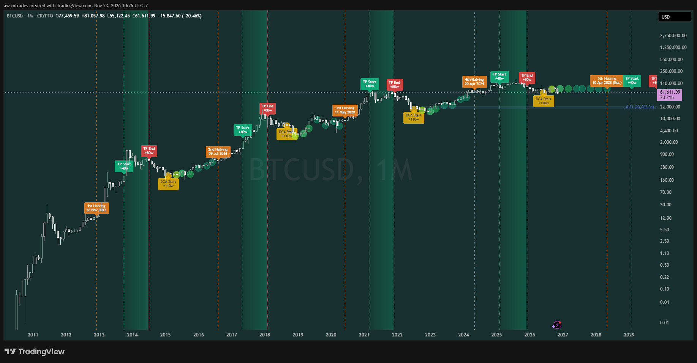

Ini penanda waktu yang saya pakai buat memantau musim siklus Bitcoin, termasuk di tulisan [Menunggu, dan Semoga Dikasih](/posts/area-akumulasi-saya/).

Kerangkanya konsep umum yang sudah lama dipakai banyak orang: kalender halving. Skripnya saya tulis sebagai indikator Pine Script buat TradingView, dan saya bagikan gratis di halaman ini — silakan pakai, ubah, atau pelajari.



## Yang ditandai

- **Tanggal halving** — yang sudah lewat, plus proyeksi halving berikutnya.
- **TP Start (+40 minggu) dan TP End (+80 minggu)** — zona waktu ambil untung setelah halving. Selama zona ini aktif, latar chart berwarna hijau.
- **DCA Start (+110 minggu)** — penanda mulai musim akumulasi, lalu titik-titik penanda berikutnya tiap **12 minggu** sampai halving selanjutnya.

Semua angka minggunya bisa diganti di pengaturan indikator, jadi kerangkanya bisa disesuaikan sama bacaan masing-masing.

## Cara pakai

1. Buka TradingView, tampilkan grafik BTCUSD — saya biasa pakai timeframe mingguan atau bulanan.
2. Buka **Pine Editor** di panel bawah, hapus isi bawaannya, lalu tempel kode di bawah ini.
3. Klik **Add to chart**. Selesai — penandanya muncul mengikuti tanggal halving.

Satu catatan jujur sebelum kodenya: penanda ini **kalender, bukan sinyal**. Dia tidak memprediksi harga dan tidak bilang kapan harus beli atau jual. Dia cuma menjawab satu pertanyaan: *sekarang kita lagi di musim apa, menurut jam halving?* Keputusan tetap di masing-masing.

## Kodenya

```
//@version=6
indicator(
     title            = "BTC Cycle Matrix [TP & DCA Tracker]", 
     shorttitle       = "BTC Matrix", 
     overlay          = true, 
     max_lines_count  = 100, 
     max_labels_count = 150
)

// ============================================================================
// 1. CONSTANTS & INPUTS
// ============================================================================
const int WEEK_MS = 7 * 24 * 60 * 60 * 1000

const string GRP_VIS  = "Visibility & Style"
const string GRP_TIME = "Cycle Timing (Weeks Post-Halving)"
const string GRP_PROJ = "Future Projection"

bool   showHalvingDate = input.bool(true, "Halving Date", group = GRP_VIS, inline = "v1")
bool   showBgColor     = input.bool(true, "Profit Zone BG", group = GRP_VIS, inline = "v1")
bool   showProfitStart = input.bool(true, "Profit START", group = GRP_VIS, inline = "v2")
bool   showProfitEnd   = input.bool(true, "Profit END", group = GRP_VIS, inline = "v2")
bool   showDCA         = input.bool(true, "DCA Markers", group = GRP_VIS, inline = "v2")
int    lineWidth       = input.int(1,     "Line Width", minval = 1, maxval = 4, group = GRP_VIS, inline = "v3")
string labelSizeInput  = input.string("Small", "Label Size", options = ["Tiny", "Small", "Normal"], group = GRP_VIS, inline = "v3")

int profitStartWeeks = input.int(40,  "Profit START (Weeks)", minval = 0, group = GRP_TIME)
int profitEndWeeks   = input.int(80,  "Profit END (Weeks)",   minval = 1, group = GRP_TIME)
int dcaStartWeeks    = input.int(110, "DCA Start (Weeks)",    minval = 1, group = GRP_TIME)
int dcaStepWeeks     = input.int(12,  "DCA Interval (Weeks)", minval = 1, group = GRP_TIME)

int halving5Time     = input.time(timestamp("10 Apr 2028 00:00 +0000"), "5th Halving (Projected)", group = GRP_PROJ)

// ============================================================================
// 2. PALETTE & DATA STRUCTURES
// ============================================================================
const color COL_HALVING = color.rgb(245, 130, 32, 15)  // Bitcoin Orange
const color COL_START   = color.rgb(16, 185, 129, 15)  // Emerald Green
const color COL_END     = color.rgb(239, 68, 68, 15)   // Crimson Red
const color COL_DCA     = color.rgb(234, 179, 8, 15)   // Amber Gold
const color COL_TEXT    = color.rgb(255, 255, 255, 0)  // Crisp White

weeksAfter(int baseTime, int weeks) => 
    baseTime + weeks * WEEK_MS

getLabelSize(string s) =>
    switch s
        "Tiny"  => size.tiny
        "Small" => size.small
        => size.normal

string lblSize = getLabelSize(labelSizeInput)

var array<int> halvingTimes = array.from(
     timestamp("UTC", 2012, 11, 28, 15, 24),
     timestamp("UTC", 2016, 7,  9, 16, 46),
     timestamp("UTC", 2020, 5,  11, 19, 23),
     timestamp("UTC", 2024, 4, 20, 0,  9),
     halving5Time,
     weeksAfter(halving5Time, 208) // 6th Halving Est. (~208 weeks after 5th)
)

var array<string> halvingNames = array.from("1st", "2nd", "3rd", "4th", "5th")

var array<color> dcaDotColors = array.from(
     color.rgb(234, 179, 8,  20),
     color.rgb(163, 230, 53, 30),
     color.rgb(74,  222, 128, 40),
     color.rgb(34,  197, 94, 50),
     color.rgb(16,  185, 129, 60)
)

// ============================================================================
// 3. HELPER FUNCTIONS
// ============================================================================
// Triggers true on the exact bar where timestamp `t` occurs
isCrossed(int t) =>
    time >= t and (na(time[1]) or time[1] < t)

drawVLine(int t, color col, string style, int width) =>
    line.new(t, low, t, high, xloc = xloc.bar_time, extend = extend.both, color = col, style = style, width = width)

drawMarker(int t, float y, string txt, color bgCol, color txtCol, string style) =>
    label.new(
         x         = t, 
         y         = y, 
         text      = txt, 
         xloc      = xloc.bar_time, 
         yloc      = yloc.price, 
         style     = style, 
         textcolor = txtCol, 
         color     = bgCol, 
         textalign = text.align_center, 
         size      = lblSize
    )

drawHalvingEvent(int t, string name, bool isProj, float yPrice) =>
    drawVLine(t, COL_HALVING, line.style_dashed, lineWidth)
    if showHalvingDate
        string dateStr = str.format_time(t, "dd MMM yyyy", "UTC")
        string projTxt = isProj ? " (Est.)" : ""
        string hLabel  = str.format("{0} Halving\n{1}{2}", name, dateStr, projTxt)
        drawMarker(t, yPrice, hLabel, COL_HALVING, COL_TEXT, label.style_label_down)
    true

drawStartEvent(int t, float yPrice) =>
    if showProfitStart
        drawVLine(t, COL_START, line.style_dotted, lineWidth)
        drawMarker(t, yPrice, str.format("TP Start\n+{0}w", profitStartWeeks), COL_START, COL_TEXT, label.style_label_down)
    true

drawEndEvent(int t, float yPrice) =>
    if showProfitEnd
        drawVLine(t, COL_END, line.style_dotted, lineWidth)
        drawMarker(t, yPrice, str.format("TP End\n+{0}w", profitEndWeeks), COL_END, COL_TEXT, label.style_label_down)
    true

drawDCAEvent(int t, float yPrice) =>
    if showDCA
        drawMarker(t, yPrice, str.format("DCA Start\n+{0}w", dcaStartWeeks), COL_DCA, color.black, label.style_label_up)
    true

drawDCADot(int t, int stepIdx, float yPrice) =>
    if showDCA
        int maxIdx = array.size(dcaDotColors) - 1
        color dotCol = array.get(dcaDotColors, math.min(stepIdx, maxIdx))
        label.new(t, yPrice, xloc = xloc.bar_time, yloc = yloc.price, style = label.style_circle, color = dotCol, size = size.tiny)
    true

// ============================================================================
// 4. BACKGROUND PROFIT ZONE LOGIC
// ============================================================================
int activeHalving = na
for i = 0 to 4
    int h = array.get(halvingTimes, i)
    if time >= h
        activeHalving := h

float zoneSpan     = float(math.max(1, profitEndWeeks - profitStartWeeks)) * WEEK_MS
float zoneProgress = not na(activeHalving) ? float(time - weeksAfter(activeHalving, profitStartWeeks)) / zoneSpan : na
bool  inProfitZone = not na(zoneProgress) and zoneProgress >= 0.0 and zoneProgress <= 1.0

color bgZoneColor  = showBgColor and inProfitZone ? color.rgb(16, 185, 129, 92 - 20 * zoneProgress) : na
bgcolor(bgZoneColor, title = "Profit Zone Background")

// ============================================================================
// 5. EXECUTION & RENDERING (ANCHORED TO EXACT BAR PRICE)
// ============================================================================
for i = 0 to 4
    int    h      = array.get(halvingTimes, i)
    int    nextH  = array.get(halvingTimes, i + 1)
    string nm     = array.get(halvingNames, i)
    bool   isProj = (i == 4)

    int tStart = weeksAfter(h, profitStartWeeks)
    int tEnd   = weeksAfter(h, profitEndWeeks)
    int tDCA   = weeksAfter(h, dcaStartWeeks)

    // 1. Historical Events: Anchored directly to the exact candle's High / Low when that week arrives
    if isCrossed(h)
        drawHalvingEvent(h, nm, isProj, high)
    if isCrossed(tStart)
        drawStartEvent(tStart, high)
    if isCrossed(tEnd)
        drawEndEvent(tEnd, high)
    if isCrossed(tDCA)
        drawDCAEvent(tDCA, low)

    int step = 0
    int dotTime = tDCA
    while dotTime < nextH
        if isCrossed(dotTime)
            drawDCADot(dotTime, step, low)
        step += 1
        dotTime := weeksAfter(h, dcaStartWeeks + dcaStepWeeks * step)

    // 2. Future Events: Any event beyond the current bar is projected once at the current price (`close`)
    if barstate.islastconfirmedhistory
        if h > time
            drawHalvingEvent(h, nm, isProj, close)
        if tStart > time
            drawStartEvent(tStart, close)
        if tEnd > time
            drawEndEvent(tEnd, close)
        if tDCA > time
            drawDCAEvent(tDCA, close)

        int fStep = 0
        int fDotTime = tDCA
        while fDotTime < nextH
            if fDotTime > time
                drawDCADot(fDotTime, fStep, close)
            fStep += 1
            fDotTime := weeksAfter(h, dcaStartWeeks + dcaStepWeeks * fStep)
```

---

*Indikator ini dibagikan apa adanya, buat alat bantu memantau musim — bukan saran keuangan. Kalau kamu ubah atau kembangkan, silakan; sebut sumbernya saja sudah cukup.*
