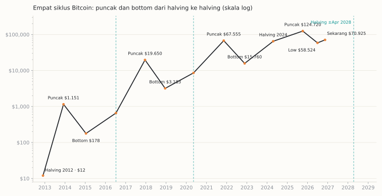
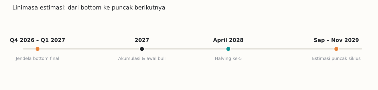

Awal Oktober kemarin, waktu Bitcoin masih di kisaran $85 ribu — baru turun sedikit dari puncak impuls $87.399 — saya menulis sebuah bacaan siklus untuk konten saya.

Suasananya waktu itu masih optimistis; banyak yang mengira reli akan lanjut terus. Bacaan saya beda di dua hal. Pertama: bottom besar siklus ini **sudah lewat** — di $57,8–58 ribu, bulan Juni 2026 kemarin, bukan di depan. Kedua: justru karena impuls dari bottom itu sudah selesai, yang menunggu di depan adalah koreksi gelombang kedua — dan koreksi itu bisa dalam, sampai ke zona fibo 61,8% (skala log) di sekitar $67,7 ribu.

Hari ini Bitcoin di kisaran $70 ribu — sedang turun menuju zona yang saya tulis itu.

Minggu ini saya meminta riset mendalam soal satu pertanyaan lanjutan: berdasarkan histori dan musimnya, kapan bull market crypto berikutnya? Riset itu mengonfirmasi satu hal soal low Juni tadi: titik terendah Bitcoin sejauh ini di siklus ini memang **$58.524, pada 30 Juni 2026** — terdalam, dan sampai hari ini belum tertembus lagi.

Satu kejujuran penting sebelum lanjut: bacaan itu saya tulis di catatan pribadi dan draf konten yang **belum pernah saya publikasikan**. Tidak ada cara bagi kamu untuk memverifikasinya selain percaya pada catatan saya — dan kamu tidak harus percaya. Yang bisa diuji publik justru bagian lanjutannya: kalau bacaan itu benar, low Juni tidak akan jebol, dan fase berikutnya berjalan seperti uraian di tulisan ini. Itu yang akan dibuktikan atau dipatahkan pasar, di depan mata semua orang.

Alasan saya menulis ini sederhana: data siklus yang terkumpul ternyata bercerita lebih menarik daripada sekadar siapa menebak apa.

## Jamnya ternyata masih tepat

Bitcoin punya jam yang terkenal: halving. Setiap kurang lebih empat tahun, imbalan penambang dipotong setengah, dan di sekitar peristiwa itulah siklus harga berputar. Yang mengejutkan bukan jamnya ada — tapi seberapa tepat ia masih berjalan:

- Siklus 2016: puncak datang **525 hari** setelah halving
- Siklus 2020: **546 hari**
- Siklus 2024: **534 hari** — puncak $124.720 pada 6 Oktober 2025

Tiga siklus terakhir memuncak dalam rentang yang terpaut hanya sekitar tiga minggu satu sama lain. Di tengah semua perdebatan "siklus empat tahunan sudah mati", siklus terakhir justru menepati jadwalnya nyaris sempurna.

Bear market-nya pun punya pola durasi: dari puncak ke titik terendah, 406 hari (2015), 364 hari (2018), 378 hari (2022) — rata-rata sekitar 383 hari. Hari ini kita berada di sekitar **hari ke-403 setelah puncak Oktober 2025**. Secara durasi murni, bear market ini sudah sepanjang bear market yang sudah-sudah.

*Empat siklus, satu ritme: garisnya naik-turun di titik-titik yang mirip setiap putaran — yang berubah cuma ketinggiannya.*

## Tapi amplitudonya patah

Ini bagian yang berubah — dan berubahnya besar. Dulu, dari halving ke puncak, Bitcoin naik 94 kali lipat (2012), lalu 29,9 kali (2016), lalu 7,9 kali (2020). Siklus kemarin? **1,9 kali.** Suaranya makin kecil setiap putaran.

Jatuhnya juga sama. Bear market dulu menggali −84,5%, −83,8%, −76,7%. Kali ini titik terendahnya "hanya" **−53,1%** dari puncak — bear market terdangkal dalam sejarah Bitcoin. Untuk pertama kalinya, harga bahkan tidak pernah jatuh di bawah rata-rata harga beli seluruh jaringan. Bitcoin sekarang di sekitar $70.900: jauh di bawah puncak, tapi juga 21% di atas titik terendah Juni itu.

Penjelasannya tidak mistis: sekarang ada ETF. Arus dana institusi lewat instrumen itu ukurannya membuat efek halving terlihat kecil — potongan pasokan dari halving 2024 hanya sekitar $29 juta per hari, sementara satu hari arus keluar ETF yang buruk bisa tujuh kali lipatnya.

Jadi kalimat yang paling jujur untuk menggambarkan siklus ini: **jamnya utuh, amplitudonya yang patah.** Waktunya masih bisa ditebak dari kalender halving. Besarnya gerakan, tidak lagi.

## Terus, bull market berikutnya kapan?

Kalau jamnya masih bisa dipercaya, hitungannya begini:

**Bottom-nya: sekarang-sekarang ini.** Jendela historisnya — puncak ditambah 364 sampai 406 hari — jatuh di Oktober 2026 sampai Januari 2027. Di sinilah para analis terbelah dua. Galaxy Research berpendapat bottom sudah lewat: ya titik $58.524 di bulan Juni itu. Analis lain seperti Benjamin Cowen masih menunggu satu kapitulasi terakhir di kuartal ini, bisa November–Desember atau molor ke Januari. Dua-duanya sepakat di satu hal: bulan-bulan ini adalah titik keputusannya, bukan awal dari bear market panjang baru.

**Fase awalnya: 2027.** Ada satu pola yang belum pernah gagal: tahun setelah bottom selalu merupakan tahun pemulihan yang kuat. 2015 naik 34%, 2019 naik 94%, 2023 naik 156%. Kalau bottom memang terbentuk di sekitar pergantian tahun ini, 2027 adalah tahun bangunnya.

**Bull penuhnya: 2028, puncaknya: akhir 2029.** Halving berikutnya diperkirakan jatuh pada April 2028. Tambahkan pola 525–546 hari, dan puncaknya jatuh di **September–November 2029, dengan titik tengah di Oktober 2029**. Peter Brandt, trader senior yang sudah melewati semua siklus, menyebut jendela yang sama persis: September/Oktober 2029.

Kalender musiman tidak banyak membantu untuk sisa tahun ini. Kuartal keempat memang bulan-bulan terkuat Bitcoin secara historis, tapi setiap kuartal keempat yang jatuh di tahun kedua setelah halving — posisi kita sekarang — selalu berakhir negatif. Oktober kemarin sudah merah. Jangan berharap keajaiban akhir tahun; berharaplah pada jamnya, bukan pada bulannya.

## Yang saya pantau

Tiga hal, supaya saya tahu skenario mana yang sedang berjalan:

1. **Low Juni bertahan atau tidak.** Kalau $58.524 jebol dengan volume besar, bacaan "bottom sudah lewat" gugur, dan kita masuk skenario kapitulasi terakhir.
2. **Keputusan The Fed 9 Desember.** Pemangkasan bunga yang tertunda-tunda adalah rem likuiditas terbesar saat ini. Jalur pemangkasan yang lebih jelas di awal 2027 akan jadi bahan bakar fase pemulihan.
3. **Arus ETF berbalik.** Dua pekan pertama November mencatat arus keluar sekitar $1,3–1,4 miliar. Selama itu belum berbalik positif secara berkelanjutan, reli apa pun masih rapuh.

## Kejujuran sebelum penutup

Sampel siklus Bitcoin cuma empat. Empat. Itu bukan statistik, itu anekdot yang kebetulan berirama. Lembaga-lembaga besar dengan analis bergaji mahal pun meleset berjamaah tahun ini — beberapa memprediksi rekor harga baru di 2026, dan yang terjadi justru harga tertinggi paruh pertama tahun ini tidak sampai $98 ribu.

Jadi tulisan ini bukan saran keuangan dan bukan ramalan. Ini catatan seorang trader kecil yang bacaannya sejauh ini belum terpatahkan pasar, lalu bertanya: kalau jamnya masih tepat sejauh ini, apa yang masuk akal untuk disiapkan?

Jawaban saya sederhana: masa akumulasi itu membosankan, dan memang seharusnya begitu. Yang seru-seru biasanya datang belakangan — kalau jamnya tidak bohong, sekitar 2028–2029.

Kamu sendiri tim yang mana: siklus masih hidup, atau kali ini benar-benar berbeda? Saya penasaran, karena dua-duanya punya data.

---

*Catatan: angka-angka siklus di tulisan ini dirangkum dari riset yang saya minta susun pada 13 November 2026 (data BTC Pulse, Galaxy Research, CoinGlass, dan estimasi analis per nama/tanggal; seluruh harga berbasis penutupan harian, level fibo pada skala log). Versi lengkapnya ada di halaman riset saya. Bukan saran keuangan — do your own research, selalu.*
